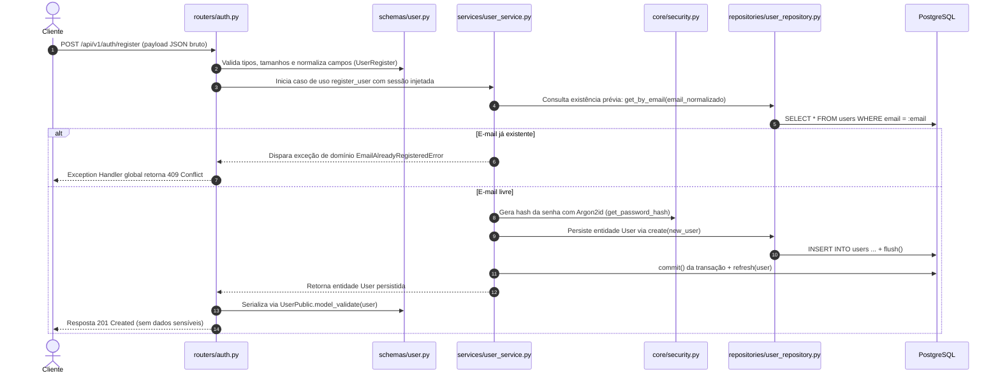

# Explicação Técnica Didática — SDD Auth-01 (Cadastro de Usuário)

Este documento apresenta a explicação técnica detalhada da implementação referente ao documento de especificação [AUTH-01.md](/docs/sdd/AUTH-01.md) (**Cadastro de Usuário com Argon2id**).

O material foi estruturado com foco pedagógico para desenvolvedores que buscam consolidar conceitos práticos de **Arquitetura Limpa**, **FastAPI assíncrono**, **SQLAlchemy 2.0**, **segurança criptográfica** e **concorrência**.

Para complementar este estudo e testar seus conhecimentos, consulte o caderno de exercícios com gabarito em [AUTH-01-QUESTOES.md](/docs/estudo/AUTH-01-QUESTOES.md).

---

## 1. Visão Geral e Fluxo de Requisição/Resposta

A funcionalidade implementa o endpoint `POST /api/v1/auth/register`, responsável por registrar uma nova conta de usuário no sistema sem emitir tokens JWT (que ficam a cargo da feature Auth-02).

Abaixo está o ciclo de vida completo da requisição, desde o momento em que o JSON chega pelo cliente até a persistência segura no banco de dados e a resposta final:

---

## 2. Detalhamento por Camadas e Componentes

### 2.1. Configuração e Infraestrutura Base
- **Arquivos:** [core/config.py](/src/instrava_api/core/config.py) e [core/database.py](/src/instrava_api/core/database.py)
- **O que foi feito:**
  - Em [config.py](/src/instrava_api/core/config.py), criamos a classe [Settings](/src/instrava_api/core/config.py#L6) baseada em `pydantic-settings`, centralizando variáveis de ambiente (como `DATABASE_URL` e `PROJECT_NAME`).
  - Em [database.py](/src/instrava_api/core/database.py), configuramos a engine assíncrona do SQLAlchemy (`create_async_engine`), o factory de sessões (`async_sessionmaker`) e o gerador de dependência [get_db](/src/instrava_api/core/database.py#L22).
- **Por que foi feito:**
  - Segue as boas práticas do *12-Factor App* (fator III: configurações no ambiente).
  - O [get_db](/src/instrava_api/core/database.py#L22) usa o padrão de gerador com context manager (`async with async_session_maker() as session: yield session`), garantindo que cada requisição HTTP receba uma sessão isolada e que a conexão seja obrigatoriamente devolvida ao pool ao término da requisição.
- **Como funciona no fluxo:**
  - O FastAPI utiliza o sistema de injeção de dependências (`Depends(get_db)`) para instanciar a sessão e repassá-la ao [UserService](/src/instrava_api/services/user_service.py#L11).
- **Conceitos-chave e armadilhas a evitar:**
  > [!TIP]
  > **Connection Leaks:** Nunca instancie conexões com o banco manualmente com `await engine.connect()` dentro de funções de negócio. Sempre dependa do context manager da sessão gerenciada pelo framework.

---

### 2.2. Segurança Criptográfica (Argon2id)
- **Arquivo:** [core/security.py](/src/instrava_api/core/security.py)
- **O que foi feito:**
  - Implementamos as funções [get_password_hash](/src/instrava_api/core/security.py#L8) e [verify_password](/src/instrava_api/core/security.py#L13) utilizando a biblioteca `pwdlib` encapsulando o hasher `Argon2Hasher`.
- **Por que foi feito:**
  - Senhas jamais devem ser salvas em texto puro ou com funções de hash rápidas (MD5, SHA-1, SHA-256). Funções rápidas foram projetadas para verificação de integridade de arquivos, permitindo que invasores testem bilhões de hashes por segundo com placas de vídeo (GPUs).
  - O **Argon2id** é a variante híbrida do Argon2 (vencedor do *Password Hashing Competition*). Ele é classificado como *memory-hard*, exigindo alocação substancial de memória RAM dedicada por cálculo, inviabilizando ataques massivos com GPUs e ASICs.
- **Como funciona no fluxo:**
  - O [UserService](/src/instrava_api/services/user_service.py#L11) recebe a senha pura do DTO, gera o hash seguro através de [get_password_hash](/src/instrava_api/core/security.py#L8) e descarta a senha pura da memória.
- **Conceitos-chave e armadilhas a evitar:**
  > [!IMPORTANT]
  > **Armadilha de Implementação Própria:** Nunca tente implementar *salting* ou funções de hash manualmente. O formato retornado pelo Argon2id (`$argon2id$v=19$m=65536,t=3,p=4$...`) já empacota o salt gerado por gerador criptográfico seguro e os parâmetros de custo.

---

### 2.3. Modelagem de Dados e Migrações (Alembic)
- **Arquivos:** [models/base.py](/src/instrava_api/models/base.py), [models/user.py](/src/instrava_api/models/user.py) e [alembic/versions/0001_create_users_table.py](/alembic/versions/0001_create_users_table.py)
- **O que foi feito:**
  - Mapeamos a tabela `users` utilizando o estilo declarativo tipado do SQLAlchemy 2.0 (`Mapped` e `mapped_column`).
  - Definimos a chave primária inteira incremental `id`, `name`, `email` com restrição de unicidade e índice (`unique=True, index=True`), `password_hash` e `created_at` com timezone UTC e default no servidor.
  - Criamos a primeira revisão de migração no Alembic ([0001_create_users_table.py](/alembic/versions/0001_create_users_table.py)) para permitir evolução e versionamento do banco.
- **Por que foi feito:**
  - Garante tipagem estática rigorosa no Python.
  - A restrição de unicidade física (`UNIQUE INDEX`) no PostgreSQL é a garantia infalível contra duplicações acidentais ou maliciosas.
- **Como funciona no fluxo:**
  - A classe [User](/src/instrava_api/models/user.py#L9) representa a entidade física persistida no banco e manipulada pelo repositório.
- **Conceitos-chave e armadilhas a evitar:**
  > [!NOTE]
  > **Fusos Horários:** Sempre utilize `DateTime(timezone=True)` e default com `datetime.now(UTC)`. O uso de datas sem fuso horário (*naive datetime*) é uma das principais fontes de bugs silenciosos em aplicações globais.

---

### 2.4. Validação e Contratos de Entrada/Saída (Schemas Pydantic)
- **Arquivo:** [schemas/user.py](/src/instrava_api/schemas/user.py)
- **O que foi feito:**
  - Criamos dois modelos distintos:
    1. [UserRegister](/src/instrava_api/schemas/user.py#L6): Schema de entrada com `name`, `email` (`EmailStr`) e `password` (8 a 16 caracteres). Inclui validadores de campo para remover espaços vazios (`strip()`) e converter o e-mail para minúsculas (`lower()`).
    2. [UserPublic](/src/instrava_api/schemas/user.py#L29): Schema de saída com `id`, `name`, `email` e `created_at`, configurado com `model_config = ConfigDict(from_attributes=True)`.
- **Por que foi feito:**
  - **Evitar Vazamento de Dados (Data Leakage):** A entidade [User](/src/instrava_api/models/user.py#L9) possui o campo `password_hash`. Se retornássemos o modelo do ORM diretamente na API, correríamos o risco de vazar hashes criptográficos em respostas HTTP ou logs.
  - **Normalização Precoce:** Tratar o e-mail na entrada (`lower()`) garante que buscas e comparações sejam imunes a variações de caixa alta/baixa.
- **Como funciona no fluxo:**
  - O FastAPI valida o body da requisição contra [UserRegister](/src/instrava_api/schemas/user.py#L6). Se houver dados inválidos, interrompe imediatamente com `422 Unprocessable Entity`.
  - No retorno da rota, `UserPublic.model_validate(user)` lê os atributos da instância do SQLAlchemy e serializa apenas os campos autorizados.
- **Conceitos-chave e armadilhas a evitar:**
  > [!TIP]
  > **`from_attributes=True`:** Essa diretiva informa ao Pydantic que os dados podem ser extraídos de atributos de objetos (`obj.id`, `obj.email`) e não apenas de dicionários convencionais (`obj["id"]`).

---

### 2.5. Camada de Acesso a Dados (Repository Pattern)
- **Arquivo:** [repositories/user_repository.py](/src/instrava_api/repositories/user_repository.py)
- **O que foi feito:**
  - Criamos a classe [UserRepository](/src/instrava_api/repositories/user_repository.py#L7), contendo os métodos:
    - [get_by_email](/src/instrava_api/repositories/user_repository.py#L11): Realiza `select(User).where(User.email == normalized_email)`.
    - [create](/src/instrava_api/repositories/user_repository.py#L18): Adiciona o usuário na sessão (`session.add(user)`) e sincroniza com o banco (`await session.flush()`).
- **Por que foi feito:**
  - **Desacoplamento:** O restante da aplicação não precisa saber qual dialeto SQL está sendo executado ou quais APIs do SQLAlchemy estão sendo usadas. Se amanhã mudarmos a forma de consulta ou adicionarmos cache (Redis), o impacto fica contido no repositório.
- **Como funciona no fluxo:**
  - O [UserService](/src/instrava_api/services/user_service.py#L11) injeta e chama o repositório para todas as operações de banco de dados.
- **Conceitos-chave e armadilhas a evitar:**
  > [!IMPORTANT]
  > **`flush()` vs `commit()`:** O repositório executa `flush()`, mas **nunca** `commit()`. O `flush` envia as instruções SQL para o PostgreSQL e popula o `id` gerado, mantendo a transação em aberto. A responsabilidade de comitar a transação de negócio pertence ao Caso de Uso (Service).

---

### 2.6. Camada de Serviço e Regras de Negócio (Service Layer)
- **Arquivos:** [services/user_service.py](/src/instrava_api/services/user_service.py) e [core/exceptions.py](/src/instrava_api/core/exceptions.py)
- **O que foi feito:**
  - Em [exceptions.py](/src/instrava_api/core/exceptions.py), declaramos [DomainError](/src/instrava_api/core/exceptions.py#L1) e a exceção de negócio [EmailAlreadyRegisteredError](/src/instrava_api/core/exceptions.py#L5).
  - Em [user_service.py](/src/instrava_api/services/user_service.py), implementamos o método [register_user](/src/instrava_api/services/user_service.py#L18):
    1. Verifica duplicidade chamando `user_repo.get_by_email`.
    2. Gera o hash seguro da senha via [get_password_hash](/src/instrava_api/core/security.py#L8).
    3. Persiste o usuário e executa `commit()` e `refresh()`.
    4. Trata **condições de corrida** (*race conditions*) capturando `IntegrityError` do SQLAlchemy e relançando como [EmailAlreadyRegisteredError](/src/instrava_api/core/exceptions.py#L5).
- **Por que foi feito:**
  - **Independência de Protocolo:** O serviço não importa `fastapi.HTTPException`. Ele lança exceções de domínio puras. Isso permite reaproveitar a regra de negócio em filas assíncronas (Celery, Kafka), rotinas em lote ou comandos CLI.
  - **Tratamento de Concorrência:** Checar `get_by_email` não é suficiente em ambientes com alta concorrência. Duas requisições simultâneas podem passar pela checagem ao mesmo tempo. O bloco `try ... except IntegrityError` garante que a colisão seja tratada com elegância.
- **Como funciona no fluxo:**
  - O router delega todo o caso de uso para [register_user](/src/instrava_api/services/user_service.py#L18), mantendo o controlador limpo.
- **Conceitos-chave e armadilhas a evitar:**
  > [!CAUTION]
  > **Concorrência e TOCTOU (Time-of-Check to Time-of-Use):** Nunca suponha que o estado do banco continuará inalterado entre o momento do `SELECT` e o momento do `INSERT`. Confie na restrição do banco para garantir consistência.

---

### 2.7. Camada Web, Roteamento e Handlers Globais
- **Arquivos:** [routers/auth.py](/src/instrava_api/routers/auth.py) e [main.py](/src/instrava_api/main.py)
- **O que foi feito:**
  - Em [routers/auth.py](/src/instrava_api/routers/auth.py), declaramos a rota [register](/src/instrava_api/routers/auth.py#L20) (`POST /api/v1/auth/register`), anotada com `response_model=UserPublic` e `status_code=201`.
  - Em [main.py](/src/instrava_api/main.py), registramos handlers globais de erro:
    - Handler para [EmailAlreadyRegisteredError](/src/instrava_api/core/exceptions.py#L5), convertendo a exceção de domínio em status HTTP `409 Conflict` com corpo padronizado: `{"detail": {"code": "EMAIL_ALREADY_REGISTERED", "message": "E-mail já cadastrado."}}`.
    - Handler global para `Exception`, garantindo que falhas inesperadas retornem status `500` com a mensagem neutra `{"detail": "Internal server error"}`.
- **Por que foi feito:**
  - Mantém as rotas extremamente enxutas (*Thin Controllers*).
  - Impede o vazamento de detalhes internos da aplicação (*Information Disclosure* / CWE-209), como stack traces ou detalhes da conexão do banco de dados.
- **Como funciona no fluxo:**
  - A rota recebe a requisição HTTP, aciona o serviço e formata a resposta. Qualquer exceção de domínio levantada é capturada automaticamente pelo exception handler correspondente.
- **Conceitos-chave e armadilhas a evitar:**
  > [!TIP]
  > **Preservação de Erros Nativos:** No handler global de `Exception`, verificamos se o erro é uma instância de `HTTPException` ou `RequestValidationError`. Se for, relançamos para permitir que os handlers padrão do FastAPI gerem as mensagens detalhadas de validação (HTTP 422).

---

### 2.8. Testes Automatizados e Confiabilidade
- **Arquivos:** [tests/conftest.py](/tests/conftest.py) e [tests/test_auth_register.py](/tests/test_auth_register.py)
- **O que foi feito:**
  - Em [conftest.py](/tests/conftest.py), configuramos um banco de dados SQLite assíncrono em memória (`sqlite+aiosqlite:///:memory:` com `StaticPool`) e substituímos a dependência [get_db](/src/instrava_api/core/database.py#L22) usando `app.dependency_overrides`.
  - Em [test_auth_register.py](/tests/test_auth_register.py), cobrimos todos os cenários de aceite descritos no SDD:
    - `AC-01`: Registro com sucesso, validação dos campos e ausência de senhas no corpo.
    - `AC-02`: Rejeição de e-mail duplicado com código 409.
    - `AC-03`: E-mails com caixas diferentes tratados como duplicados.
    - `AC-04`, `AC-05`, `AC-06`: Validações de e-mail inválido, tamanho de senha e campos obrigatórios (422).
    - `AC-07`: Verificação de que o hash no banco é Argon2id válido.
    - Teste de condição de corrida simulado com `unittest.mock.patch` forçando `IntegrityError`.
    - Teste de erro 500 garantindo ausência de vazamento de dados confidenciais.
- **Por que foi feito:**
  - Permite rodar a suíte inteira em menos de meio segundo, sem precisar de containers Docker ativos ou rede externa.
- **Como funciona no fluxo:**
  - O `httpx.AsyncClient` executa requisições assíncronas reais contra o ASGI da aplicação FastAPI.
- **Conceitos-chave e armadilhas a evitar:**
  > [!TIP]
  > **Mocks Pontuais:** Simular uma condição de corrida no banco real exigiria testes não determinísticos com múltiplas threads. Usar `patch` para forçar a exceção `IntegrityError` no método `UserRepository.create` é a melhor forma de validar o tratamento de erros sem criar testes lentos ou instáveis (*flaky tests*).

---

## 3. Resumo dos Padrões Arquiteturais Utilizados

| Padrão / Prática | Onde foi aplicado | Benefício Principal |
| :--- | :--- | :--- |
| **Separation of Concerns (SoC)** | Camadas `routers`, `schemas`, `services`, `repositories`, `models` | Cada camada tem uma única responsabilidade bem delimitada. |
| **Dependency Injection** | `Depends(get_db)` e construtor do [UserService](/src/instrava_api/services/user_service.py#L11) | Facilita testes automatizados e desacopla a criação dos objetos de seu uso. |
| **Repository Pattern** | [UserRepository](/src/instrava_api/repositories/user_repository.py#L7) | Isola a lógica de persistência e dialetos de banco de dados do restante da aplicação. |
| **Data Transfer Object (DTO)** | [UserRegister](/src/instrava_api/schemas/user.py#L6) e [UserPublic](/src/instrava_api/schemas/user.py#L29) | Impede vazamento acidental de campos sensíveis (`password_hash`). |
| **Domain Exceptions** | [EmailAlreadyRegisteredError](/src/instrava_api/core/exceptions.py#L5) | Desacopla as regras de negócio de códigos de status HTTP e frameworks web. |
| **Defesa em Profundidade** | Validação no Schema + Check no Service + Unique Index no Banco | Garante consistência mesmo sob condições extremas de concorrência. |

---

## 4. Próximos Passos no Estudo
Para fixar esses conceitos, avance para a resolução das 10 questões práticas e conceituais disponíveis em:
👉 [docs/estudo/AUTH-01-QUESTOES.md](/docs/estudo/AUTH-01-QUESTOES.md)
