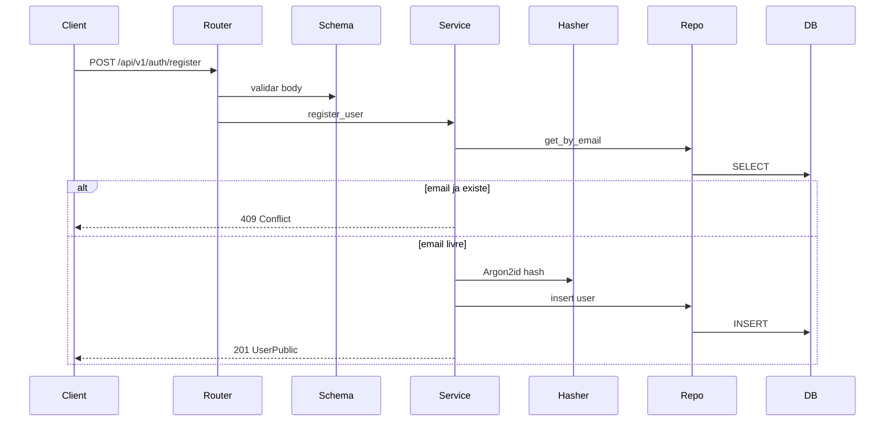

# SDD Auth-01 — Cadastro de Usuário


| Campo       | Valor                                                                                                                                 |
| ----------- | ------------------------------------------------------------------------------------------------------------------------------------- |
| Feature     | Auth-01                                                                                                                               |
| Módulo      | Autenticação e Gestão de Usuários                                                                                                     |
| Fase        | Fase 1 — Estruturação e Autenticação                                                                                                  |
| Status      | Implementado                                                                                                                          |
| Referências | [Documento do projeto](../documento_do_projeto.md), [Modelagem de dados](../modelagem_de_dados.md), [ERD DBML](../dbdiagram_erd.dbml) |


---

## 1. Identificação e escopo

O Auth-01 define o cadastro de usuário na API Instrava: registro com nome, e-mail e senha armazenada com Argon2id. Este documento é o contrato de desenho para a implementação da rota de registro na Fase 1.

### 1.1 Dentro do escopo

- Endpoint `POST /api/v1/auth/register`
- Persistência na tabela `users` (PostgreSQL)
- Validação de payload com Pydantic
- Hash da senha com Argon2id antes de gravar
- Unicidade de e-mail (case-insensitive)
- Respostas HTTP de sucesso e erro de negócio
- Migração Alembic inicial da tabela `users`


### 1.2 Fora do escopo

- Login e emissão de JWT ([Auth-02](../documento_do_projeto.md))
- Proteção de rotas / middleware ([Auth-03](../documento_do_projeto.md))
- Verificação de e-mail, recuperação de senha, OAuth social
- Front-end (formulário de registro)
- Tabela `activities` e demais entidades do domínio esportivo

---


## 2. Requisitos


### 2.1 Funcionais


| ID    | Requisito                                                                                                              |
| ----- | ---------------------------------------------------------------------------------------------------------------------- |
| RF-01 | O cliente envia `name`, `email` e `password` em JSON.                                                                  |
| RF-02 | Em sucesso, a API persiste o usuário e devolve `201 Created` com dados públicos (`id`, `name`, `email`, `created_at`). |
| RF-03 | A senha nunca é devolvida, nem em texto puro nem como hash.                                                            |
| RF-04 | O e-mail é único na base, comparado após normalização (`trim` + `lower`).                                              |
| RF-05 | E-mail já cadastrado resulta em `409 Conflict` com código estável `EMAIL_ALREADY_REGISTERED`.                          |
| RF-06 | Payload inválido resulta em `422 Unprocessable Entity` (validação Pydantic).                                           |
| RF-07 | O cadastro **não** emite JWT. Autenticação permanece no Auth-02.                                                       |


### 2.2 Não funcionais


| ID     | Requisito                                                           |
| ------ | ------------------------------------------------------------------- |
| RNF-01 | API FastAPI assíncrona (Python 3.12+).                              |
| RNF-02 | Persistência em PostgreSQL via SQLAlchemy 2.0 assíncrono + Alembic. |
| RNF-03 | Senha armazenada com Argon2id.                                      |
| RNF-04 | Logs não incluem senha nem o body bruto da requisição de registro.  |
| RNF-05 | Falhas inesperadas respondem `500` sem detalhe interno.             |


### 2.3 Regras de validação

- `name`: string obrigatória, `strip()`, comprimento 1–100.
- `email`: `EmailStr` (RFC; dependência `email-validator`), normalizado para minúsculas e sem espaços nas pontas antes da consulta/gravação.
- `password`: string obrigatória, comprimento mínimo 8 caracteres (máximo 16, para limitar custo de hash). Sem exigência de complexidade neste portfólio.

---


## 3. Arquitetura


### 3.1 Decisões

- **ORM:** SQLAlchemy 2.0 (mapped style) com sessão assíncrona.
- **Migrações:** Alembic (revisão única neste módulo: criar `users`).
- **Hash:** Argon2id via `pwdlib[argon2]` (ou `argon2-cffi` equivalente), encapsulado em `core`.
- **Resposta de sucesso:** usuário público, sem token.


### 3.2 Camadas

Código previsto sob `src/instrava_api/`:


| Camada     | Pasta                               | Responsabilidade                                                     |
| ---------- | ----------------------------------- | -------------------------------------------------------------------- |
| Router     | `routers/`                          | HTTP, status codes, injeção de `AsyncSession`. Sem regra de negócio. |
| Schema     | `schemas/`                          | `UserRegister` (entrada) e `UserPublic` (saída).                     |
| Service    | `services/`                         | Unicidade de e-mail, hash, orquestração do insert.                   |
| Repository | junto ao service ou `repositories/` | `get_by_email`, `insert`.                                            |
| Model      | `models/`                           | Entidade SQLAlchemy `User` → tabela `users`.                         |
| Core       | `core/`                             | `get_password_hash`, settings, sessão de banco.                      |


O nome da tabela segue o ERD (`users`), não o rótulo conceitual `usuarios`.

### 3.3 Fluxo




Reserva para Auth-02: `User.id` será o `sub` do JWT. Este módulo não gera nem valida tokens.

---


## 4. Modelo de dados

O modelo conceitual cita `usuarios (id, name, email, password, created_at)`. Na implementação física, `password` **não** é persistido em texto puro.

### 4.1 Tabela `users`


| Coluna          | Tipo           | Restrições                  | Notas                                       |
| --------------- | -------------- | --------------------------- | ------------------------------------------- |
| `id`            | `INTEGER`      | PK, identity                | Gerado pelo banco.                          |
| `name`          | `VARCHAR(100)` | `NOT NULL`                  | Nome de exibição.                           |
| `email`         | `VARCHAR(255)` | `NOT NULL`, unique          | Sempre gravado em minúsculas. Índice único. |
| `password_hash` | `VARCHAR(255)` | `NOT NULL`                  | Hash Argon2id. Nunca exposto na API.        |
| `created_at`    | `TIMESTAMPTZ`  | `NOT NULL`, default `now()` | UTC.                                        |


Relação futura `users.id` 1–N `activities.user_id` existe no ERD e **não** é criada neste SDD.

### 4.2 Migração

Uma revisão Alembic no Auth-01: `CREATE TABLE users` + índice único em `email`. Sem seeds de usuário.

---


## 5. Contrato da API


### 5.1 Endpoint

```
POST /api/v1/auth/register
Content-Type: application/json
```

Autenticação: nenhuma.

### 5.2 Request

```json
{
  "name": "Maria Silva",
  "email": "maria@example.com",
  "password": "senha-secreta"
}
```

Schema Pydantic sugerido: `UserRegister`.

### 5.3 Response `201 Created`

```json
{
  "id": 1,
  "name": "Maria Silva",
  "email": "maria@example.com",
  "created_at": "2026-10-15T21:00:00Z"
}
```

Schema Pydantic sugerido: `UserPublic` (`from_attributes=True`). Header opcional `Location: /api/v1/users/{id}` pode ser adicionado na implementação; o recurso GET de usuário não faz parte deste SDD.

### 5.4 Erros


| Status | Quando                                                                                     | Corpo                                                                                  |
| ------ | ------------------------------------------------------------------------------------------ | -------------------------------------------------------------------------------------- |
| `422`  | Validação Pydantic (campo ausente, e-mail inválido, senha com menos de 8 caracteres, etc.) | Detalhe padrão FastAPI.                                                                |
| `409`  | E-mail já cadastrado (após normalização)                                                   | `{"detail": {"code": "EMAIL_ALREADY_REGISTERED", "message": "E-mail já cadastrado."}}` |
| `500`  | Falha inesperada                                                                           | Sem stack trace nem SQL.                                                               |


Conflito de unique constraint no insert (corrida entre dois cadastros) deve ser mapeado para o mesmo `409`.

---


## 6. Segurança

- Hash Argon2id **somente** no service/core, depois da validação do schema.
- Senha em memória apenas até o hash; não persistir, não logar, não incluir em `UserPublic`.
- `password_hash` fica restrito ao modelo ORM e às queries internas.
- Resposta `409` explícita facilita o cliente, mas permite enumeração de e-mail. Aceitável neste portfólio; documentado como trade-off. Mitigações futuras (rate limit, mensagem genérica) ficam fora do Auth-01.
- Auth-02/03 não são implementados aqui. A interface reservada é `User.id` como identificador estável para `sub` do JWT.

---


## 7. Critérios de aceite e testes

Implementação considerada aceita quando os cenários abaixo passarem (Pytest, API de teste + PostgreSQL ou equivalente).


| ID    | Cenário                                                                                              | Resultado esperado                                                                        |
| ----- | ---------------------------------------------------------------------------------------------------- | ----------------------------------------------------------------------------------------- |
| AC-01 | Payload válido, e-mail novo                                                                          | `201`; body contém `id`, `name`, `email`, `created_at`; sem `password` / `password_hash`. |
| AC-02 | Mesmo e-mail duas vezes                                                                              | segundo request `409` com `EMAIL_ALREADY_REGISTERED`.                                     |
| AC-03 | E-mail existente com caixa diferente (`Maria@example.com` vs `maria@example.com`)                    | `409`.                                                                                    |
| AC-04 | E-mail inválido                                                                                      | `422`.                                                                                    |
| AC-05 | Senha com menos de 8 caracteres                                                                      | `422`.                                                                                    |
| AC-06 | Campo obrigatório ausente                                                                            | `422`.                                                                                    |
| AC-07 | Após `201`, registro no banco tem `password_hash` diferente do plaintext e verificável com Argon2id. |                                                                                           |


---


## 8. Dependências previstas (implementação futura)

Não instalar neste trabalho de documentação. Na implementação do Auth-01, acrescentar em `pyproject.toml`:

- `sqlalchemy[asyncio]`
- `asyncpg`
- `alembic`
- `pydantic-settings`
- `email-validator`
- `pwdlib[argon2]`

Estrutura de pastas alinhada ao roadmap: `routers/`, `services/`, `models/`, `schemas/`, `core/` em `src/instrava_api/`.